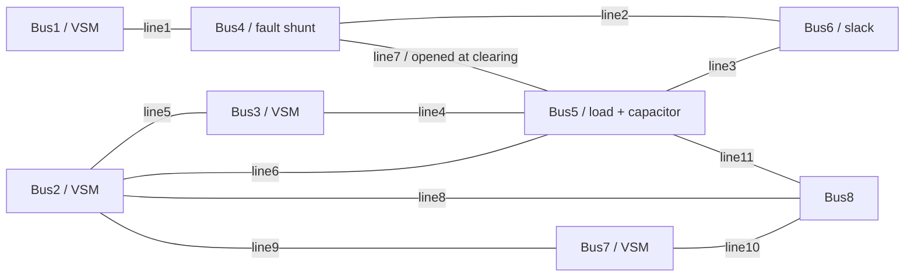

# VSMを用いた8母線・4台インバータ系統のシミュレーション

本リポジトリは、Virtual Synchronous Machine（VSM）の慣性・周波数制御を備えた4台のインバータと、固定電圧源に接続された8母線系統の時間領域シミュレーション環境です。Bus5には定インピーダンス負荷と並列コンデンサを接続し、Bus4での短絡事故を模擬するシャント投入と線路4–5の開放を扱います。

このREADMEは、論文から参照できる**モデル・パラメータ・計算手順の説明書**です。標準ケースは **H=2.5 s、mₚ=0.10（10%）、D₁=0**。以下はすべてこのケースの条件であり、収録済みの過去の比較資料には別の設定も含まれます。

- [1. コードの構成と役割](#1-コードの構成と役割)
- [2. VSMを含む電力系統の構成](#2-vsmを含む電力系統の構成)
- [3. 使用するパラメータ](#3-使用するパラメータ)
- [4. シミュレーションの再現方法](#4-シミュレーションの再現方法)

## 1. コードの構成と役割

時間積分とモデル構築にはJulia、計算後のデータ処理と描画にはPythonを使用します。通常の利用では、入力CSVを編集し、`code/run.jl`を実行します。

| ファイル・ディレクトリ | 役割 |
|---|---|
| [code/run.jl](code/run.jl) | 実行入口。モデルを読み込み、指定したケースCSVを実行 |
| [code/current_case.jl](code/current_case.jl) | 現在のCSV形式の読込、パラメータ設定、平衡点補正、事故切替、時間積分、出力 |
| [code/model.jl](code/model.jl) | 凍結した元モデルと数値計算機能の読込 |
| [code/vsm.jl](code/vsm.jl) | VSMの運動方程式、D₁・D₂の減衰、周波数状態の座標変換 |
| [code/engine12.jl](code/engine12.jl) | 代数変数の整合化、電圧・電流・電力などの観測量の計算 |
| [code/analyze_current.py](code/analyze_current.py) | 時系列の整理、機別判定の照合、描画 |
| [data/representative.csv](data/representative.csv) | 標準ケースの入力。変更可能な主要条件を1行に記載 |
| [data/smoke.csv](data/smoke.csv) / [data/demo.csv](data/demo.csv) | 短時間の動作確認用 / D₁を変更した複数ケース用の入力 |
| [data/current_reference/](data/current_reference/) | 事故前・事故中・事故後の基準パラメータベクトルと平衡点の初期推定値 |
| [data/states.csv](data/states.csv) | 保存する66成分の状態・代数変数の添字と名称 |
| [provenance/source_snapshot/](provenance/source_snapshot/) | 元の系統・回路・制御器の凍結ソース |
| [provenance/Project.toml](provenance/Project.toml) / [Manifest.toml](provenance/Manifest.toml) | Juliaの依存パッケージと固定バージョン |
| `runs/current/<case>/` | 再計算で生成するデータ。Git管理対象外 |
| [code/export_single_line_data.jl](code/export_single_line_data.jl) / [code/plot_single_line.py](code/plot_single_line.py) | 保存状態から系統図用データを抽出 / 系統図を描画 |
| [paper_materials/](paper_materials/) | 別途整理した論文用の図・レポート・元データ |

元環境は[Droop系統のリポジトリ](https://github.com/hashima0205/gfm-deceleration-separated-equilibria)のコミット`3569b4cba0f5d6bee9e7bf1377ec9c52a599cc11`です。その回路・制御器・系統を利用し、有効電力側をVSMの周波数状態へ置換しています。現在の入力はさらにBus5の容量性補償と系統・負荷の調整を含みます。元環境の条件をそのまま標準入力として使用するわけではありません。

## 2. VSMを含む電力系統の構成

### 2.1 母線と接続

| 母線 | 接続機器・役割 |
|---|---|
| Bus1 | VSMインバータ。線路1–4を介して接続 |
| Bus2・Bus3・Bus7 | VSMインバータ |
| Bus4 | 中継母線、および事故模擬用シャントの接続点 |
| Bus5 | 定インピーダンス負荷と容量性サセプタンスの並列接続点 |
| Bus6 | 固定slack電圧源。電圧1 pu、位相0 rad、周波数60 Hz |
| Bus8 | 中継母線。独立した負荷・電源なし |

以下は接続関係の模式図です。線路番号は3.4節のパラメータ表と対応します。



事故前・事故中は11線路を接続します。事故除去時にline7（Bus4–Bus5）のみを開放し、事故後は10線路です。線路は代数的な直列R–Xモデルで、線路の並列アドミタンスは0、変圧比は1です。

### 2.2 各インバータの構成と電力の測定位置

全4台で同じ制御構成を使用します。電気回路は、制御電圧源Vᵢ、インバータ側Rf–Lf、並列フィルタC、系統側Rg–Lg、接続母線Uの順です。

```text
P* − Pcap → VSM（H, mp, D1, D2）→ 内部位相 δ
Q* − Qcap → Q測定フィルタ・Q–V制御 → 電圧指令 V*
                 δ, V* → 電圧PI → 電流指令制限 → 電流PI → Vᵢ

Vᵢ ── Rf,Lf ──● Vc ── Rg,Lg ──● U ── 系統線路
       If →    │          Ig →
               C
               │
              基準点
```

VSMとQ–V制御に入力する複素電力は **Scap=Vc Ig\*** です。ここでVcはフィルタコンデンサ電圧、Igは系統側インダクタを流れる出力方向の電流、*は複素共役を表します。接続母線での複素電力は **Sterm=U Ig\*** として別に保存します。両者は測定位置が異なり、Rg–Lg間の損失・エネルギー変化を含むため同じ量ではありません。

本モデルは正相の平均値モデルです。スイッチング波形、直流側電圧・エネルギー源の動特性、PLLによる周波数追従はモデル化していません。電圧・電流PIとLCL回路は動的に計算します。

### 2.3 VSMの方程式

各機の内部角周波数をω、基準角周波数をω₀、pu周波数偏差をν=(ω−ω₀)/ω₀とします。内部位相δは基準周波数で回転する座標系、すなわち固定slack Bus6を基準とする角度です。

$$
M\dot\nu=P^*-P_{\mathrm{cap}}-(D+D_1)\nu-D_2(\nu-z),
$$

$$
\dot z=\omega_D(\nu-z),\qquad \dot\delta=\omega_0\nu,
$$

$$
D=\frac{1}{m_p},\qquad M=2H,\qquad
P_{\mathrm{cap}}=\operatorname{Re}(V_C I_g^*).
$$

- **H**：仮想慣性定数。Mはこの式で使用する慣性係数です。
- **mₚ・D**：P–fドループ勾配とその逆数。同じ機構を表し、独立した2つの減衰指定ではありません。
- **D₁**：固定基準周波数からの偏差νに比例する追加減衰。定常偏差にも作用します。
- **D₂・ωD**：ウォッシュアウト型の追加過渡減衰。入力νから減衰電力までの伝達関数はD₂s/(s+ωD)です。νが一定ならz→νとなり、その定常出力は0です。

D₁を加えた定常P–f勾配は1/(D+D₁)です。D₂はこの定常勾配には加算しません。D₁・D₂は本モデルでは両方とも固定基準周波数からの偏差を使用します。

実装は元のP測定フィルタの4状態をνへ置換します。互換性のための換算はKp=ω₀mₚ、τp=M/D=2Hmₚです。**VSMとは別にτpのP測定フィルタを追加しているわけではありません。** 保存用の`Pf_pu`はPf=P*−Dνへ逆変換した量で、VSMが実際に参照する電力は`Pcap_pu`です。

Q側はτq Q̇f=Qcap−Qf、電圧指令はV*=Vset−Kq(Qf−Qset)です。D₂用の各機1状態を含め、積分系全体は**56微分状態＋14代数変数**です。

## 3. 使用するパラメータ

### 3.1 単位・基準・符号

時間は秒、位相はrad、周波数はHz、角周波数はrad/sを使用します。電圧・電流・電力・インピーダンス・アドミタンスは、モデルのpu系における値です。有効・無効電力は、インバータから系統への注入を正とします。負荷の消費電力とコンデンサの供給無効電力は以下で区別します。

モデルには物理単位の共通基準容量Sbase、基準電圧Vbase、各機定格との対応を指定していません。したがって、下表をそのままMW・kV・H・Fの実機値とは読み替えません。Lf・Lgは基準周波数でのpuリアクタンス、Cはpuサセプタンスに相当するモデル係数です。物理ベースを別途定義する場合は、Zbase=Vbase²/SbaseとしてLphysical=Xpu Zbase/ω₀、Cphysical=Bpu/(ω₀ Zbase)により換算します。

### 3.2 VSM・指令値・Q–V制御

表の共通設定はBus1・2・3・7のすべてに適用します。

| 記号 / CSV・コード名 | 標準値 | 意味・単位 |
|---|---:|---|
| f₀ | 60 | 基準周波数 [Hz] |
| ω₀ / `ω0` | 376.99111843077515 | 2πf₀ [rad/s] |
| H / `H` | 2.5 | 仮想慣性定数 [s] |
| M=2H | 5 | 運動方程式の慣性係数 [s] |
| mₚ / `mp` | 0.10 | pu周波数 / pu電力。10%ドループ |
| D=1/mₚ | 10 | ドループ由来の減衰 [pu電力 / pu周波数] |
| D₁ / `D1` | 0 | 追加比例減衰 [pu電力 / pu周波数] |
| D₂ / `D2` | 100 | 追加過渡減衰の高周波ゲイン [pu電力 / pu周波数] |
| ωD / `omega_d` | 50 | ウォッシュアウトの極 [s⁻¹]。時定数0.02 s |
| Kp=ω₀mₚ / `droop₊Kp` | 37.69911184307752 | 元コード座標での角周波数ゲイン [(rad/s)/pu電力] |
| τp=M/D / `droop₊τ_p` | 0.5 | VSMへの換算に使う時定数 [s] |
| Vset / `droop₊Vset` | 1 | Q–V制御の電圧基準 [pu] |
| Kq / `droop₊Kq` | 0.05 | Q–Vドループ係数 [pu電圧 / pu無効電力] |
| τq / `tauq` | 0.02 | 無効電力測定の一次遅れ時定数 [s] |

**入力CSVの`mp`には`0.10`を指定します。`10`ではありません。** Hとmₚは独立に指定でき、M・D・Kp・τpは上記の関係から計算されます。

| 接続母線 | P* / CSV列 | 有効電力指令 [pu] | Qset [pu] |
|---|---|---:|---:|
| Bus1 | `P1` | 0.5 | 0.16370094127236381 |
| Bus2 | `P2` | 0.4 | 0.197690040391902 |
| Bus3 | `P3` | 0.4 | 0.11248584940369824 |
| Bus7 | `P7` | 0.4 | 0.05232080478579085 |

Qsetは基準パラメータベクトルから引き継ぐ機別の固定値です。事故投入・除去時にP*・Qset・Vset・H・mₚ・D₁・D₂を変更しません。

### 3.3 LCLフィルタ・電圧制御・電流制御

以下も全4台で共通です。VSMの慣性・周波数制御に接続する、インバータの回路・内側制御の設定です。

| 記号 / コード名 | 標準値 | 意味 |
|---|---:|---|
| Rf / `vsrc₊Rf` | 0.0139 | インバータ側フィルタ抵抗 [pu] |
| Lf / `vsrc₊Lf` | 0.0196 | インバータ側フィルタリアクタンス [pu] |
| C / `vsrc₊C` | 0.1086 | フィルタ容量性サセプタンス [pu] |
| Rg / `vsrc₊Rg` | 0.01 | 系統側フィルタ抵抗 [pu] |
| Lg / `vsrc₊Lg` | 0.0209 | 系統側フィルタリアクタンス [pu] |
| Kpv / `vsrc₊VC_KP` | 1.4476 | 電圧PIの比例ゲイン |
| Kiv / `vsrc₊VC_KI` | 0.0273 | 電圧PIの積分ゲイン |
| Kpi / `vsrc₊CC1_KP` | 0.9817 | 電流PIの比例ゲイン |
| Kii / `vsrc₊CC1_KI` | 0.0018 | 電流PIの積分ゲイン |
| `vsrc₊VC_F` / `vsrc₊CC1_F` | 1 / 1 | 電圧制御の電流FF / 電流制御の電圧FFを有効化 |
| `vsrc₊VC_Fcoupl` / `vsrc₊CC1_Fcoupl` | 1 / 1 | dq軸間干渉の補償係数 |
| Rvirt / Xvirt | 0 / 0 | 仮想インピーダンス [pu] |
| Imax / `vsrc₊I_max` | 1.2 | 電圧PIが出力する電流指令の制限値 [pu] |

PIの積分状態はγ̇v=Vc,ref−Vc、γ̇i=If,ref−Ifで定義され、制御出力にそれぞれKiv γv、Kii γiを加えます。時間は秒です。電流指令制限は、制限前のdq指令ベクトルuに対して、α=min(1, Imax/√(ud²+uq²+10⁻⁶))を乗じる方式です。実電流そのものを1.2 puに固定する制約ではなく、積分器のアンチワインドアップは実装していません。実装は[compornent.jl](provenance/source_snapshot/compornent.jl)を参照してください。

### 3.4 線路

表は現在の基準ケースで実際に使用する値です。すべてpu、事故前は全線路が接続状態です。全桁の値は[branches.csv](data/single_line/pre_equilibrium/branches.csv)に保存しています。

| 線路 | 接続母線 | R [pu] | X [pu] | 事故除去後 |
|---|---|---:|---:|---|
| line1 | 1–4 | 0.1209434790198695 | 0.4513672085462936 | 接続 |
| line2 | 4–6 | 0.05140712362360391 | 0.1918539972342641 | 接続 |
| line3 | 5–6 | 0.2593035794543550 | 0.9677341331081263 | 接続 |
| line4 | 3–5 | 0.11711269009163834 | 0.4370705096330626 | 接続 |
| line5 | 2–3 | 0.13550735345681714 | 0.5057203279000357 | 接続 |
| line6 | 2–5 | 0.1209434790198695 | 0.4513672085462936 | 接続 |
| line7 | 4–5 | 0.1437883583902893 | 0.5366254590494824 | **開放** |
| line8 | 2–8 | 0.11927144935600034 | 0.44512710888897156 | 接続 |
| line9 | 2–7 | 0.04050376292684206 | 0.15116210114069928 | 接続 |
| line10 | 7–8 | 0.1531473639659886 | 0.5715537433663126 | 接続 |
| line11 | 5–8 | 0.02888605414090633 | 0.1078042216840478 | 接続 |

`grid_k=0.6812730259441179`はline2・line3のR・Xを調整する係数です。上表にはこの調整を**適用済み**です。入力CSVでkを変更すると、この2線路を上表の値×(k/0.6812730259441179)へ変更し、他の線路は保持します。

### 3.5 Bus5の負荷・並列コンデンサ

Bus5は定電力負荷ではなく、一定のアドミタンスY₅=G+jBを持つ負荷・補償の組合せです。

| 記号 / CSV列 | 標準値 | 意味 |
|---|---:|---|
| G / `load_G` | 2.2682301152333055 | 負荷コンダクタンス [pu] |
| B / `Bcap` | 1.0 | 容量性サセプタンス [pu] |

$$
P_{\mathrm{load}}=G|U_5|^2,\qquad
Q_{\mathrm{cap,supply}}=B|U_5|^2,\qquad
S_{\mathrm{Bus5,injection}}=(-G+jB)|U_5|^2.
$$

したがって、Gは消費する一定の電力そのものではありません。B>0は無効電力供給を表します。並列コンデンサは事故前の負荷母線の電圧低下を補償する目的で設置し、事故前・事故中・事故後を通して接続します。実行時には事故前Bus5電圧が0.98 pu以上であることを確認します。

元コードの負荷は`z_fraction=1`で、内部の`P_load_p/vref2=G`、`Q_load_p/vref2=−B`に対応します。現在のCSV入口では`load_G`と`Bcap`を上表のG・Bとして扱います。

### 3.6 事故シナリオ

| 項目 / CSV列 | 標準値 |
|---|---|
| 事故母線 | Bus4 |
| 投入時刻 / `fault_on` | 絶対時刻1.00 s |
| 事故継続時間 / `T` | 0.15 s |
| 事故シャント / `fault_G` | 消費方向のコンダクタンス20 pu |
| 除去時刻 | 絶対時刻1.15 s |
| 除去時の操作 | 事故シャント除去と同時にline7（4–5）を開放 |
| 除去後の計算時間 / `horizon` | 1000 s（終了絶対時刻1001.15 s） |

事故は正相モデルでの抵抗性シャントとして模擬し、投入中の消費有効電力は20|U₄|² puです。元の接続電流の符号に合わせ、内部の`G_fault_p`には−20を格納します。入力CSVの`fault_G=20`は消費コンダクタンスの大きさです。

### 3.7 初期状態・数値計算条件

初期状態には[data/current_reference/pre_root.csv](data/current_reference/pre_root.csv)を初期推定値として、現在の条件で補正した事故前平衡点を用います。PI積分状態とLCL状態もこの平衡点から与え、すべてを0で初期化しません。D₂の内部状態は各機でz=νとして開始します。

| 項目 | 標準設定 `level=A` |
|---|---|
| 積分器 | OrdinaryDiffEqの`Rodas5P`、質量行列形式のDAE |
| 相対 / 絶対許容誤差 | 10⁻⁹ / 10⁻¹¹ |
| 最大時間刻み | 0.005 s（適応刻み） |
| 出力時刻の間隔 | 事故前0.01 s / 事故中0.0005 s / 事故後0.02 s |
| 平衡点・代数制約の検査 | 残差10⁻⁸未満 |
| 事故前条件の検査 | Bus5電圧0.98 pu以上、補正した平衡点の局所安定性を確認 |
| 事故後の基準平衡点 | `post_root.csv`から補正し、局所安定性を確認 |
| イベント処理 | 事故前・事故中・事故後を分割積分。微分状態を保持し、14代数変数だけを整合化 |

D₂の状態zもイベントをまたいで連続に引き継ぎます。事故切替の時間平滑化は行いません。`level=B`では相対誤差10⁻¹⁰、絶対誤差10⁻¹²、最大刻み0.0025 sへ変更します。出力時刻の間隔は積分器の内部刻みとは異なります。

## 4. シミュレーションの再現方法

### 4.1 環境の準備

Julia **1.12.5**と、`provenance/Manifest.toml`の固定環境を使用します。主要パッケージはPowerDynamics 4.4.0、NetworkDynamics 0.10.16、ModelingToolkit 10.32.1です。Pythonの検証環境は **3.13.9**、NumPy 2.3.4、pandas 2.3.3、Matplotlib 3.10.6です。以下は現在の標準入口と後処理に必要な構成です。

```bash
git clone https://github.com/hashima0205/VSM_decelaration.git
cd VSM_decelaration

julia --project=provenance -e 'using Pkg; Pkg.instantiate()'

python3.13 -m venv .venv
source .venv/bin/activate
python -m pip install numpy==2.3.4 pandas==2.3.3 matplotlib==3.10.6
```

以下はリポジトリ直下での実行例です。初回の依存関係取得・コンパイルには時間がかかります。`Pkg.update()`は行わず、同梱Manifestのバージョンを使用してください。[code/requirements.txt](code/requirements.txt)は元環境の解析一式に対する別の固定指定を残したもので、ここで検証したPython構成とは区別します。

### 4.2 入力の確認と標準ケースの実行

```bash
python code/check_current.py
python code/check_vsm_base.py

OPENBLAS_NUM_THREADS=1 JULIA_NUM_THREADS=1 \
julia --project=provenance --startup-file=no code/run.jl
```

引数なしでは[data/representative.csv](data/representative.csv)を読み込みます。H・mₚ・D₁などを明示した入力は次の1行です。

```csv
case,H,mp,D1,D2,omega_d,Bcap,grid_k,load_G,P1,P2,P3,P7,tauq,fault_on,T,fault_G,horizon,level
current_D1_0_H2p5_mp0p10_B1,2.5,0.1,0,100,50,1,0.6812730259441179,2.2682301152333055,0.5,0.4,0.4,0.4,0.02,1,0.15,20,1000,A
```

Juliaの出力で各段の`CURRENT_START`と、完了時の`CURRENT_DONE`を確認します。短時間の動作確認だけを行う場合は、事故後30秒を計算する次の入力を使います。

```bash
OPENBLAS_NUM_THREADS=1 JULIA_NUM_THREADS=1 \
julia --project=provenance --startup-file=no code/run.jl smoke.csv
```

### 4.3 出力と後処理

標準ケースの出力先は`runs/current/current_D1_0_H2p5_mp0p10_B1/`です。

| 出力 | 内容 |
|---|---|
| `settings.csv` | 入力値、導出したD・M・τpなど |
| `pre_parameters.csv` / `fault_parameters.csv` / `post_parameters.csv` | 実際に積分した各段の全パラメータ |
| `pre_root.csv` / `post_root.csv` | 現在の条件で補正した平衡点 |
| `observations.csv` | 各機の位相・周波数、電圧・電流、P/Q、電流指令と制限状態など |
| `pre.bin` / `fault.bin` / `post.bin` | 各段の保存状態とD₂内部状態を含むチェックポイント |
| `full_states.bin` | 全区間の状態、パラメータ、基準平衡点をまとめたJuliaデータ |
| `result.csv` / `machines.csv` | 計算条件・数値検査・機別の判定 |
| `configuration.sha256` | 入力行・モデルコード・基準入力の組合せを識別する署名 |

`observations.csv`の`b1_`・`b2_`・`b3_`・`b7_`は各接続母線の機器です。`t_absolute_s`は開始からの絶対時刻、`t_post_s`は事故除去時を0とする時刻です。イベント時刻には前後それぞれの段の行を保存するため、同じ時刻が複数行現れます。`stage`列で区別してください。

`delta_rad`は内部位相のslack基準であり、Bus5電圧位相や事故前値を差し引いていません。Bus5基準の内部角を作る場合はδ−arg(U₅)、その事故前点を0とする場合はさらに事故前の同量を差し引きます。接続母線の電圧位相arg(U)と内部位相δも区別してください。

後処理を実行するには、次のコマンドを使用します。

```bash
python code/analyze_current.py runs/current/current_D1_0_H2p5_mp0p10_B1
```

出力先に整理した時系列`response.csv.gz`、照合記録`validation.json`、`figures/`を生成します。全状態を使う系統図の作成方法は[docs/SINGLE_LINE.md](docs/SINGLE_LINE.md)を参照してください。Juliaのバイナリは同じJulia・依存環境で読み込み、他のツールとのデータ交換にはCSVを使用してください。

### 4.4 条件の変更・複数ケース・再開

1. `data/representative.csv`を、例えば`data/my_cases.csv`へコピーします。
2. `case`を新しい名前へ変更し、必要な列を編集します。複数行を記載すると順に計算します。
3. 次のように`data/`からの相対パスを引数へ渡します。

```bash
OPENBLAS_NUM_THREADS=1 JULIA_NUM_THREADS=1 \
julia --project=provenance --startup-file=no code/run.jl my_cases.csv
```

H・mₚ・D₁・D₂・ωD・Bなどは全4台共通、P指令は各機別に指定できます。Qset、PI、LCL回路などは基準ベクトルを引き継ぎます。新形式CSVでは`D1`・`D2`・`omega_d`列が実際の設定であり、旧形式入口用の環境変数`VSM_D1`等では上書きしません。

`demo.csv`にはD₁=0・10・20の3ケースがあります。標準の実行時間はいずれも事故後1000秒です。Hとmₚを変更するとτpは自動で更新されます。現在の入口はB>0、事故前Bus5電圧0.98 pu以上、事故前後の基準平衡点が局所安定である条件を確認し、満たせない場合は停止します。広範な負荷・系統変更では、平衡点の初期推定値も別途探索する必要があります。

同じ入力・コードで再実行すると、完了済み区間のチェックポイントを再利用します。入力やモデルを変更したのに同じ`case`名の出力が残っている場合は、混在を防ぐため停止します。条件を変える際は新しいケース名を使ってください。

### 4.5 論文からの参照

論文では、使用したリポジトリURLに加えて**実際に計算したコミットIDと入力CSVのパス・ケース名**を記録してください。コミットIDは以下で取得できます。

```bash
git rev-parse HEAD
```

これにより、READMEや標準値が将来更新されても、使用したモデル・依存環境・パラメータを特定できます。論文で標準ケースから変更した条件は、その入力CSVとともに明記してください。

過去の図・レポートは[paper_materials/README.md](paper_materials/README.md)、標準ケースの検証記録は[docs/CURRENT_VALIDATION.md](docs/CURRENT_VALIDATION.md)、旧Droop環境の説明は[docs/LEGACY_DROOP.md](docs/LEGACY_DROOP.md)に分けて保存しています。
