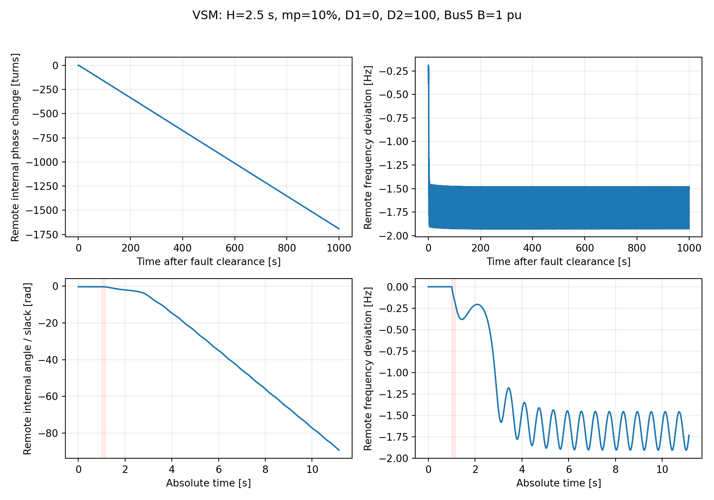
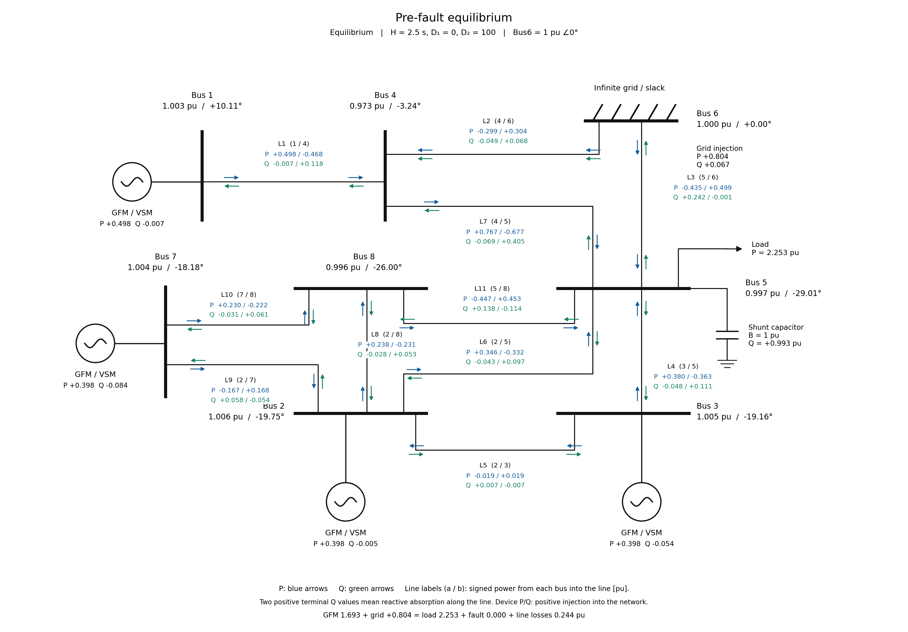

# VSM系統の負方向回転と同期回復

現在の基準ケースは **D₁＝0、H＝2.5秒、mₚ＝10%（0.10）**。Bus5に容量性サセプタンスB＝1 puを加え、事故前電圧0.99659 puを確保した8母線・4機VSM系統です。入力は [data/representative.csv](data/representative.csv)、詳しい条件・実行方法は [CURRENT_CASE.md](docs/CURRENT_CASE.md) にまとめています。

| 基準パラメータ | 値 |
|---|---:|
| H / M＝2H | 2.5 s / 5 s |
| mₚ / D＝1/mₚ | 0.10〔10%〕 / 10 |
| D₁ / D₂ / ωD | 0 / 100 / 50 s⁻¹ |
| VSM換算用τp＝M/D | 0.5 s |
| Bus5容量性B / 事故前電圧 | 1 pu / 0.996594324 pu |
| 系統係数k | 0.6812730259441179 |
| 負荷G | 2.2682301152333055 pu |
| P指令 Bus1/2/3/7 | 0.5 / 0.4 / 0.4 / 0.4 pu |

mₚはpu周波数／pu電力のドループ勾配です。**mₚ＝10という値ではありません。** コードの角周波数ゲインはKp＝ω0mₚ、慣性はM＝2Hです。Hとmₚを独立に指定し、換算用τpを自動計算します。

## 基準ケースの保存結果



事故投入は絶対1.00秒、除去は1.15秒。除去と同時に線路4–5を開きます。Bus2・3・7はslack Bus6に対して負方向へ回転し、Bus1は同期回復する例です。事故後1000秒の遠方平均内部角変化は約−1691.483回転。局所安定な事故後平衡点は存在します。

図の上段は事故除去後1000秒、下段は事故前から除去後10秒までです。内部角はslack基準のrad表示で、事故前点を0へ移していません。回転は有限時間の判定であり、永久回転の数学的証明ではありません。

[PDF](figures/current/trajectory.pdf) ／ [圧縮時系列](results/current_reference/response.csv.gz) ／ [機別判定](results/current_reference/machines.csv)

## 再計算する

```bash
git clone https://github.com/hashima0205/VSM_decelaration.git
cd VSM_decelaration
julia --project=provenance -e 'using Pkg; Pkg.instantiate()'
python -m pip install -r code/requirements.txt
python code/check_current.py
julia --project=provenance --startup-file=no code/run.jl
python code/analyze_current.py runs/current/current_D1_0_H2p5_mp0p10_B1
```

引数なしで現在の基準ケースを1000秒計算します。事故後30秒の動作確認は `code/run.jl smoke.csv`、D₁＝0／10／20の比較は `code/run.jl demo.csv`。新形式のCSVではH・mp・D1・D2・B等を明記しています。D1/D2はCSVが実際の設定で、旧入口用の環境変数に依存しません。出力は `runs/current/<case>/` に保存します。

保存結果だけを再描画する場合はJuliaや新しい時間積分は不要です。

```bash
python code/analyze_current.py --saved
```

ケース名を変えずに条件を変更した場合は、古いチェックポイントの再使用を拒否します。詳細は [実行仕様](docs/CURRENT_CASE.md) を参照してください。

## 系統図



[事故後安定平衡点](figures/single_line/post_equilibrium.png) ／ [図の一覧](figures/single_line/README.md) ／ [描画コードと入力](docs/SINGLE_LINE.md)

事故後安定平衡点の図は、回転する実軌道の到達状態ではありません。系統は8母線・11線路、GFMはBus1・2・3・7、固定slackはBus6、定インピーダンス負荷と並列コンデンサはBus5です。

## Google Driveに整理した論文用資料

[paper_materials](paper_materials/README.md) に補償後の31図、統合レポート、図版集、図用CSV、元レポート・監査表を収録しました。

- [Git更新時点の最新基準](paper_materials/UPDATE_20261105.md)
- [統合レポートPDF](paper_materials/report/REPORT_JA.pdf)
- [全31図の図版集PDF](paper_materials/report/FIGURE_CATALOG.pdf)
- [図一覧CSV](paper_materials/report/FIGURE_CATALOG.csv)
- [展開後に使えるHTML入口](paper_materials/index.html)

**収録図は元の条件のままです。** F01–F30にはD₁＝10／20やR低減の比較が含まれ、F31がD₁＝0の回転例です。標準設定の変更によって、既存の引き込み領域をD₁＝0で再計算したことにはなりません。直近のPIエネルギー蓄積の検討、補償前の図、Droop参考図はこの論文用資料に含めていません。

## モデルと履歴

Pフィルタ状態をpu周波数偏差へ置換した詳細VSMモデルです。LCL回路、電圧・電流PI、Q–V制御、電流指令制限、既存ネットワークは保持しています。追加D₂の4状態を含み、56微分状態＋14代数変数です。

```text
M νdot = Pset − Pcap − (D+D1)ν − D2(ν−z)
zdot = ωD(ν−z)
δdot = ω0ν
```

[VSM移植の記録](docs/VSM.md) ／ [追加減衰の定義](docs/VSM_DAMPING.md) ／ [今回の基準と検証](docs/CURRENT_CASE.md)

クローン元のDroop保存結果は [LEGACY_DROOP.md](docs/LEGACY_DROOP.md)、旧入力は `data/legacy/` に保存しています。旧結果と現在の基準ケースは区別してください。
